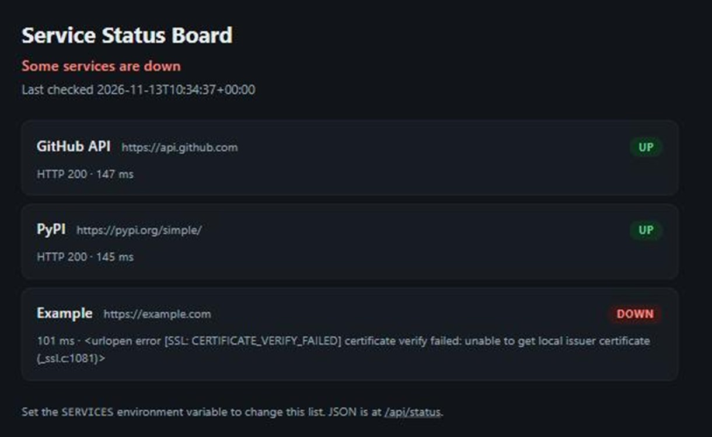

# Service Status Board — a containerised Flask app

[](https://github.com/ashwinikrishna2025-sketch/docker-flask-status-board/actions/workflows/ci.yml)

A small Flask web app that checks whether a list of HTTP services is up and
shows the result as a status page and a JSON API.

The app is deliberately simple. The point of this project is **the container
around it**: a multi-stage build, a non-root user, a real health check, a
production server, and a CI pipeline that builds the image and proves it runs
before publishing it.



## What it does

| Endpoint | Purpose |
| --- | --- |
| `GET /` | The status board as an HTML page |
| `GET /api/status` | The same data as JSON; returns `503` if anything is down |
| `GET /healthz` | Liveness probe — answers `{"status": "ok"}` and makes no outbound calls |

Which services get checked is configuration, not code. Set `SERVICES` to a
comma-separated list of `Name=URL` pairs:

```
SERVICES="GitHub API=https://api.github.com,Internal API=https://api.example.internal/health"
```

Checks run in parallel and the results are cached for a few seconds, so
refreshing the page does not hammer every service.

## Run it

### With Docker Compose

```bash
docker compose up --build
```

Then open http://localhost:8000.

### With Docker on its own

```bash
docker build -t status-board .
docker run --rm -p 8000:8000 -e SERVICES="GitHub=https://api.github.com" status-board
```

### Without Docker, for development

```bash
python -m venv .venv
source .venv/bin/activate        # Windows: .venv\Scripts\activate
pip install -r requirements-dev.txt
flask --app app.main run --port 8000
```

## Configuration

| Variable | Default | Meaning |
| --- | --- | --- |
| `SERVICES` | three public URLs | Comma-separated `Name=URL` pairs to check |
| `PORT` | `8000` | Port the container listens on |
| `CACHE_TTL_SECONDS` | `15` | How long results are reused before re-checking |
| `CHECK_TIMEOUT_SECONDS` | `5` | Per-request timeout for each check |

## What the container does properly

These are the decisions worth reading the `Dockerfile` for:

- **Multi-stage build.** Dependencies are installed into a virtualenv in a
  builder stage. The runtime image copies that virtualenv and the application
  code, so pip, its cache and the build tooling never ship.
- **Runs as a non-root user.** The image creates `appuser` and switches to it
  before the entrypoint. CI asserts this is still true.
- **A real `HEALTHCHECK`.** It calls `/healthz` through `app/healthcheck.py`,
  so Docker (and anything else reading container health) knows when the app is
  actually serving, not just when the process exists.
- **gunicorn, not the Flask development server.** Started with `exec` so
  gunicorn is PID 1 and receives `SIGTERM`, which means a clean shutdown
  instead of a ten-second kill.
- **Layer caching that works.** `requirements.txt` is copied and installed
  before the application code, so editing the app does not reinstall Flask.
- **A `.dockerignore`.** Tests, CI config, the virtualenv and any `.env` file
  stay out of the build context and out of the image.

## CI

[`.github/workflows/ci.yml`](.github/workflows/ci.yml) runs on every push and
pull request:

1. **Lint and test** — `ruff check` and `pytest`.
2. **Build and smoke-test the image** — builds with Buildx and layer caching,
   starts the container, waits for `/healthz`, requests `/api/status` and `/`,
   and checks the process is running as `appuser`.
3. **Publish** — on `main` only, pushes the image to the GitHub Container
   Registry tagged `latest` and with the commit SHA.

So a green tick means the image really builds and really serves traffic, not
just that the tests passed.

```bash
ghcr.io/ashwinikrishna2025-sketch/docker-flask-status-board:latest
```

## Tests

```bash
pytest
```

Ten tests cover the config parsing, the cache (including that it does not
re-check within its TTL) and every endpoint. None of them touch the network —
the checks are stubbed — so the suite is fast and gives the same answer
everywhere.

## Layout

```
.
├── Dockerfile              # multi-stage build, non-root, healthcheck
├── compose.yaml            # one-command local run
├── .dockerignore           # keeps the build context and image small
├── app/
│   ├── main.py             # Flask routes
│   ├── checks.py           # the checks and their cache
│   ├── healthcheck.py      # used by the container HEALTHCHECK
│   └── templates/
│       └── index.html      # the status page
├── tests/
│   └── test_app.py
└── .github/workflows/ci.yml
```

## Licence

MIT — see [LICENSE](LICENSE).
